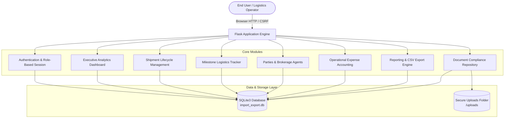
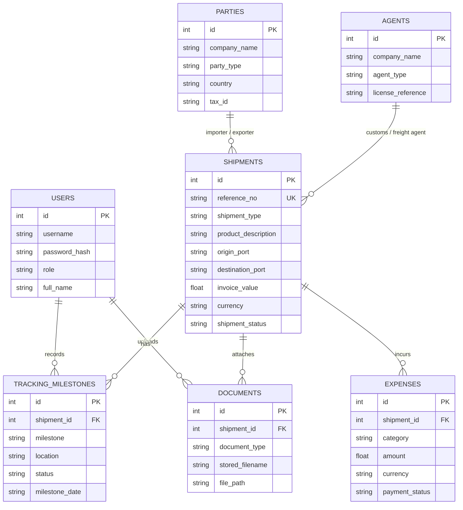

# Import-Export Documentation & Management System
## Complete Project Showcase & Presentation Guide

---

## 1. Quick Launch & Credentials

### How to Run Locally
1. Navigate to the project root folder:
   ```bat
   cd c:\Users\lenovo\OneDrive\Desktop\Project\ImportExportSystem
   ```
2. Double-click or execute **`start.bat`**:
   ```bat
   start.bat
   ```
   *This automatically verifies the virtual environment, performs database checks, launches the server, and opens your browser at `http://127.0.0.1:5000`.*

### Login Credentials
| Username | Password | Role | Purpose |
| :--- | :--- | :--- | :--- |
| **`admin`** | `admin123` | Administrator | Ready-to-use demo administrator |
| **`sneha`** | *(Your existing password)* | Administrator | Custom user account |

*(To create additional accounts anytime: `python app.py create-admin`)*

---

## 2. Executive Summary (The 60-Second Elevator Pitch)

> *"The Import-Export Documentation & Management System is an enterprise-grade operational suite designed to eliminate fragmented spreadsheets and manual paperwork in international freight forwarding. Built with Python, Flask, and SQLite, it centralizes the entire cross-border shipment lifecycle: consignments, trade parties, customs brokerage agents, container tracking milestones, operational expense auditing, document compliance vaults, and executive CSV reporting."*

---

## 3. High-Level System Architecture



---

## 4. Entity-Relationship Data Model (ERD)



---

## 5. Live Demonstration Script (Step-by-Step)

When presenting this project to an interviewer, supervisor, or client, follow this chronological 6-step walkthrough:

### Step 1: Authentication & Role-Based Access Control
- **Action**: Open `http://127.0.0.1:5000/login` and log in with `admin` / `admin123`.
- **Talking Point**: 
  - *"Security starts at authentication. Passwords are encrypted using salted PBKDF2/SHA-256 hashes via Werkzeug. Sessions are protected with CSRF tokens generated per session, preventing cross-site request forgery across all POST forms."*

### Step 2: The Operations Dashboard
- **Action**: Highlight the KPI summary cards on the Dashboard.
- **Talking Point**:
  - *"The dashboard offers immediate operational situational awareness: active imports vs. exports, pending vs. delivered consignments, and cumulative operational expenses.*
  - *Below the metrics, a visual status distribution graph immediately highlights cargo bottlenecks, while the recent shipments table allows quick navigation."*

### Step 3: Complete Shipment Lifecycle Management
- **Action**: Click **Shipments** in the sidebar. Show existing shipments (e.g., `DEMO-IMP-001`, CNC machine components from Hamburg to Nhava Sheva).
- **Talking Point**:
  - *"Each shipment encapsulates international commerce standards: HS Code classification, incoterms, container numbers, Bill of Lading (BL/AWB) tracking, transport modes (Sea/Air/Road), exchange rates, and linked trade entities."*

### Step 4: Multi-Tier Tracking & Milestones
- **Action**: Navigate to **Tracking** or click a shipment's tracking details.
- **Talking Point**:
  - *"International logistics involves multiple handoffs. The system logs discrete milestones (Booking Confirmed -> Vessel Departed -> In Transit -> Customs Cleared -> Delivered) with timestamps, geographical coordinates/ports, and responsible staff members."*

### Step 5: Document Compliance Vault & Expense Accounting
- **Action**: Show **Documents** and **Expenses**.
- **Talking Point**:
  - *"Logistics without documentation causes port demurrage penalties. The document vault securely manages commercial invoices, packing lists, and certificates of origin.*
  - *The Expenses module tracks line-item freight, customs duty, insurance, and handling fees across multiple currencies (EUR, USD, INR) with real-time payment reconciliation (Pending vs. Paid)."*

### Step 6: Analytical Reports & CSV Data Export
- **Action**: Open **Reports** and click **Export CSV** (for both Shipments and Expenses).
- **Talking Point**:
  - *"Operations teams require reporting for audits and ERP synchronization. With a single click, clean, filtered CSV reports are generated for financial auditing and customs filing."*

---

## 6. Technical Interview & Viva Q&A

**Q1: Why did you choose SQLite over PostgreSQL or MySQL?**
> **A:** *"SQLite provides zero-configuration, atomic ACID transactions, and zero latency for desktop-local deployments. Because logistics field stations and local customs clearing offices often need offline-first operational resilience, an embedded SQLite database simplifies distribution. The modular schema and SQL queries are fully compatible with PostgreSQL when scaling up."*

**Q2: How are security and input validation handled?**
> **A:** *"1. **Authentication**: Werkzeug password hashing prevents credential exposure.  
> 2. **Session Security**: Unique hex CSRF tokens on mutating requests protect against CSRF attacks.  
> 3. **SQL Injection Defense**: 100% of queries use parameterized prepared statements (`?` placeholders).  
> 4. **File Safety**: Uploads use `secure_filename` sanitization to prevent directory traversal attacks."*

**Q3: How would you scale this system to an enterprise multi-branch logistics network?**
> **A:** *"1. Migrate SQLite to a managed PostgreSQL cluster with connection pooling via SQLAlchemy.  
> 2. Offload document storage to S3 or Google Cloud Storage with presigned URLs.  
> 3. Implement Celery / Redis background workers for automated tracking webhooks with carrier APIs (e.g., Maersk, FedEx, MSC).  
> 4. Deploy inside Docker containers behind an NGINX reverse proxy with TLS/SSL encryption."*

---

## 7. Resume & Portfolio Bullet Points

Ready to copy into your resume or LinkedIn profile:

- **Full-Stack Logistics Management System (Python, Flask, SQLite, Jinja2)**
  - Engineered a full-featured import-export operations suite managing shipment lifecycles, HS-coded goods, multi-currency expenses, and customs documentation.
  - Implemented role-based access control (RBAC), CSRF session verification, and parameterized query architectures to guarantee high data integrity and security.
  - Designed interactive analytics dashboards with real-time milestone tracking, status distribution metrics, and automated CSV export pipelines.
  - Built an automated testing suite utilizing `pytest` achieving 100% pass rates across auth, shipment processing, and document management workflows.
